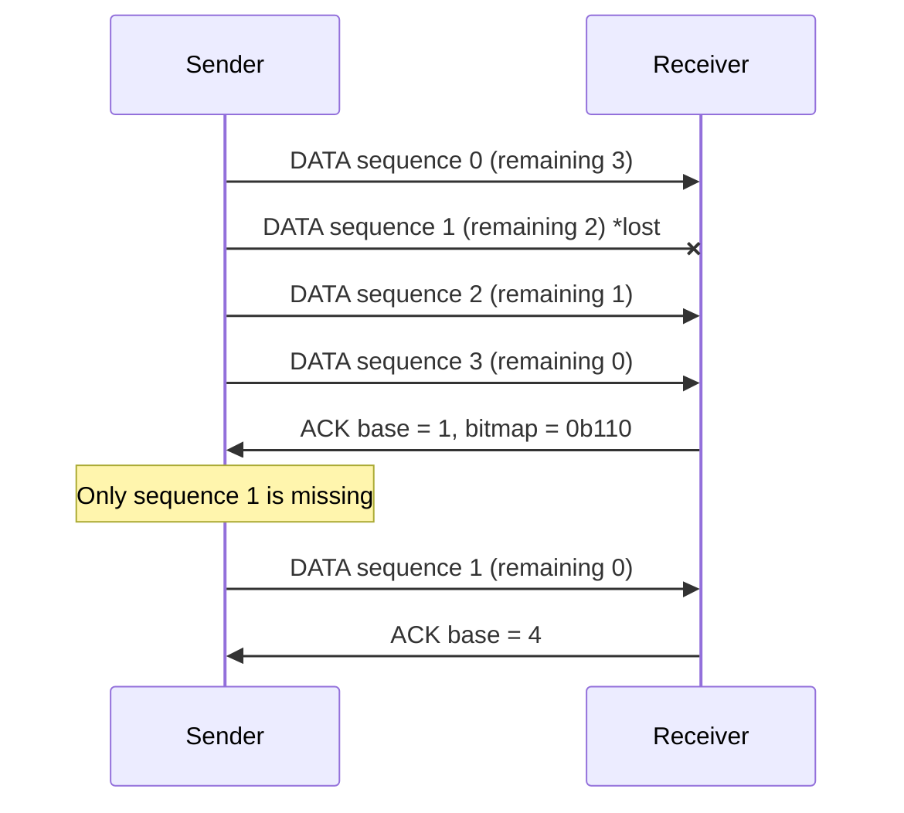

# Wireless Transceiver

## About
  This is a project to improve the transmission reliability of the nRF24L01+. Initially, the project started with Stop-and-Wait ARQ but now has been adapted to utilize Selective Repeat ARQ with a custom CRC-CCITT-16 layer.

  This is a reliable link layer for the nRF24L01+ radio, written bare-metal on an STM32L476. It replaces the radio's built in Enhanced ShockBurst (ESB) with my own protocol: Selective Repeat ARQ, and software CRC-CCITT-16, and bitmap ACKs with POLLing.

  ## Simulation Results
  All results are from a register-level nRF24L01+ simulator that models both plain ShockBurst and Enhanced Shockburst timing as per the datasheet, with 5 MHz SPI timing. "Burst interference" means a jammer occupying the channel 30% - 50% of the time in 30 ms - 100 ms bursts. 3,000 messages per condition, on random seeds separate from those used for tuning.

| Channel | Messages Lost (SR) | Messages Lost (ESB) |
| --- | --- | --- |
| Clean | 0% | 0% |
| 20%-50% random loss | 0% | 0%|
| Burst interference (30% duty, 30 ms) | 0% | 1.4% |
| Burst interference (50% duty, 30 ms) | 0% | 3.7% |
| Burst interference (50% duty, 100 ms) | 0% | 4.4% |

<i>Graph was created using AI by feeding raw CSV files</i>

  + Up to 26% higher message rate than Enhanced ShockBurst.
  + Up to 2x fewer retransmissions (lost ACKs are recovered via POLLing)
  + 2.3x - 5.6x the throughput of a Stop-and-Wait baseline
  + 0 lost messages (For non extreme circumstances)

## Extreme Cases

<i>Graph was created using AI by feeding raw CSV files</i>

This graph is here to give a clearer picture during extreme cases for messages lost. Generally, this is something that is unlikely to happen during normal use, but represents the difference between the two protocols.

At the extremes, Selective Repeat also loses messages (loses 19 out of 60,000 messages) with 2-second jammer bursts, and 5.2% when the channel is jammed 95% of the time. Every one of those losses was reported to the sender. ESB loses 5.4% and 70% in the same conditions.

## How it works
| Layer | Details |
| --- | --- |
| Application Layer | link_send() / link_flush() / link_poll_recv() |
| Link Layer | SR Window (16), Framing, CRC-16, link_SR.c, bitmap, POLLing |
| Radio Driver | Auto-ACK Off, Auto-Retry Off, Hardware CRC Off |
| Port Layer | SPI, GPIO, Delays (Board-Specific), port.c |

The sender transmits up to 16 frames back to back, and then waits for one ACK whose 16-bit bitmap says which frames arrived. The next burst only resends the missing frames.

If an ACK frame is lost, the sender sends a short POLL frame and the receiver repeats its ACK frame instead of resending the whole burst.

## Frame Formats (32 bytes)

| Bytes | Data | ACK | POLL |
| --- | --- | --- | --- |
| 0 | Type | Type | Type |
| 1 | Sequence | Base (next sequence) | N/A |
| 2 | Frames remaining in burst | Bitmap (High Byte) | N/A |
| 3 | length (0 - 26) | Bitmap (Low Byte) | N/A |
| 4 - 29 | Data (26 bytes) | N/A | N/A |
|30 - 31 | CRC-16/CCITT | CRC-16/CCITT | CRC-16/CCITT |

## Design Decisions
+ Hardware CRC was turned off for software CRC for error correction in the future.
+ Bitmap ACKs instead of per-frame ACKs to save on turnaround time from TX to RX transmission.
+ The ACK timeout is shorter than the receiver's silence timeout because the sender knows when its burst ended.

## Pinouts
| nRF24L01+ | Nucleo-L476RG |
| --- | --- |
| SCK | PB13 (SPI2) |
| MISO | PB14 (SPI2) |
| MOSI | PB15 (SPI2) |
| CSN | PB12 |
| CE | PC7 |
| IRQ | N/A |
| VCC | 3v3 (with 10 uF capacitor) |
| GND | GND |

SPI2: Mode 0 at 5 MHz.
Radio Channel: Channel 76 (2476 MHz), 250 kbps.

## Planned Features
+ Non-blocking link_service() state machine
+ Session resync after one-sided board reset
+ Forward error correction and interleaving
+ Frequency Hopping

