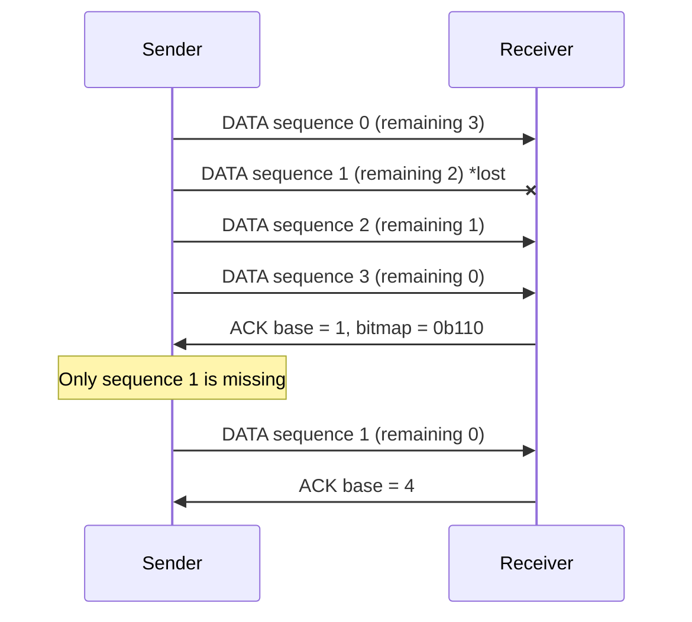
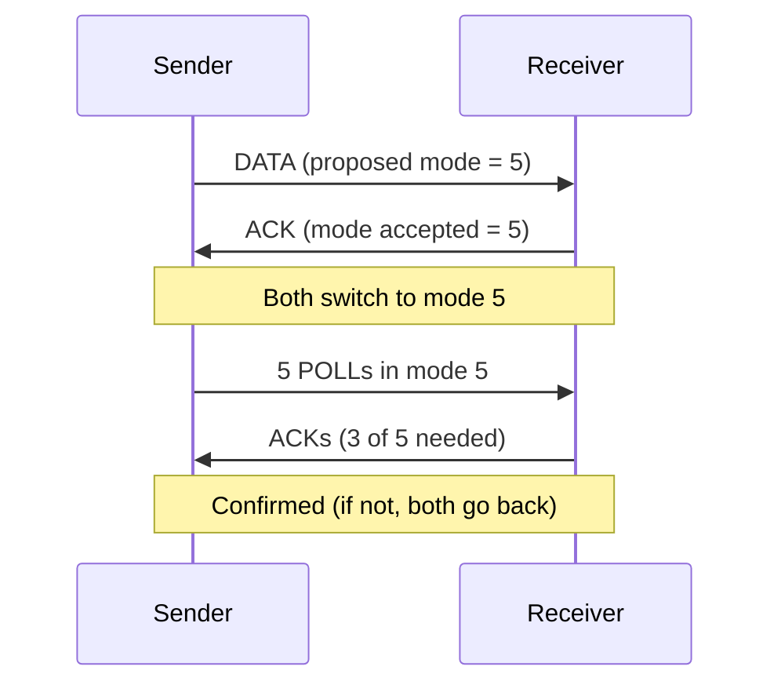

# Wireless Transceiver

## About
  This is a project to improve the transmission reliability of the nRF24L01+. Initially, the project started with Stop-and-Wait ARQ but now has been adapted to utilize Selective Repeat ARQ with a custom CRC-CCITT-16 layer.

  This is a reliable link layer for the nRF24L01+ radio, written bare-metal on an STM32L476. It replaces the radio's built in Enhanced ShockBurst (ESB) with my own protocol: Selective Repeat ARQ, and software CRC-CCITT-16, and bitmap ACKs with POLLing.

  The new version introduces a adaptive algorithm to the link that tunes itself to the channel. It picks its own data rate, and error correction while it runs, repairs damaged bytes inside each frame, and compresses text with packing and adaptive Huffman tables to optimize throughput.

| Feature | What It Does |
| --- | --- |
| Selective Repeat ARQ | Sends up to 16 frames per burst and ACKs have 16-bit bitmaps to notify which frames have been received. |
| Automatic Data Rate | Moves between 250 kbps, 1 Mbps, and 2 Mbps, with or without bit repair, based on how each mode performs. Both boards confirm all switches via handshakes.|
| Reed-Solomon Repair | Repairs up to 2 damaged bytes per frame before the CRC check to avoid resends. |
| FIFO Streaming | Keeps the radio's 3-frame TX FIFO loaded with CE held high, so frames go out back to back without a 130 us PLL settle before each transmission. This stays under the 4 ms limit as per the datasheet. |
| Message Packing | Packs messages back to back into frames allowing several short commands to share one frame, and messages up to 200 bytes span several frames. |
| Adaptive Huffman Compression | Compresses text messages. The sender counts the characters of the messages that gets sent, switches to a better table when said table would save at least 3%, sends that table to the receiver, and saves it to flash for the next power-up. It either uses the default table or makes a new table on the fly. A message is never more than 1 byte bigger than its raw text. |


<sub><i>Fig. 1. Throughput versus signal margin with each protocol at its best data rate. SR chooses its own rate and ESB uses the fastest fixed rate. Simulated drone commands with Rician fading (K = 4), 3 s per point.</i></sub>

<sub><i>Graph was created using AI by feeding raw CSV files</i></sub>

+ 2.0x to 5.4x the throughput compared to ESB with each test case at it's best data rate.
+ 1.8x to 2.4x the throughput compared to ESB at the same 250 kbps data rate.
+ 0 lost messages in every normal condition tested while ESB loses up to 5% of frames under burst interference.

  ## Simulation Results
  All results are from a register-level nRF24L01+ simulator that models both plain ShockBurst and Enhanced Shockburst timing as per the datasheet, with 5 MHz SPI timing. "Burst interference" means a jammer occupying the channel 30% - 50% of the time in 30 ms - 100 ms bursts. 3,000 messages per condition, on random seeds separate from those used for tuning.

| Channel | Lost (SR Any) | Lost (ESB 250 kbps) | Lost (ESB 1 Mbps) | Lost (ESB 2 Mbps) |
| --- | --- | --- | --- | --- |
| Clean | 0% | 0% | 0% | 0% |
| 20% Random Loss | 0% | 0% | 0% | 0% |
| 50% Random Loss | 0% | 0% | 0% | 0% |
| Burst interference (30% duty, 30 ms) | 0% | 0.4% | 1.6% | 1.9% |
| Burst interference (50% duty, 30 ms) | 0% | 1.1% | 3.7% | 4.0% |
| Burst interference (50% duty, 100 ms) | 0% | 4.6% | 5.2% | 4.7% |
| Signal Margin 30 dB (close) | 0% | 0% | 0% | 0% |
| Signal Margin 16 dB | 0% | 0% | 0% | 0% |
| Signal Margin 13 dB | 0% | 0% | 0% | 0% |
| Signal Margin 8 dB | 0% | 0% | 0% | 15% |
| Signal Margin 4 dB (far) | 0% | 0% | 39% | 98% |

### Throughput


<sub><i>Fig. 2. Throughput at a fixed 250 kbps rate under random frame loss and jammer bursts.</i></sub>

In Fig. 1, ESB is given the fastest fixed data rate, while this link fids its rate by itself. ESB can't change its rate on its own. This forces ESB to stick within a static setting which limits it's capabilities.

| Channel | ESB 250k | SR 250k | ESB 1M | SR 1M | ESB 2M | SR 2M | SR auto |
| --- | --- | --- | --- | --- | --- | --- | --- |
| Clean | 79 | 183 | 181 | 706 | 230 | 1241 | 1070 |
| 20% Random Loss | 49 | 115 | 111 | 385 | 136 | 571 | 427 |
| 50% Random Loss | 18 | 42 | 42 | 107 | 49 | 153 | 52 |
| Burst Interference (30% duty, 30 ms) | 55 (0.4% lost) | 118 | 125 (1.6% lost) | 451 | 158 (1.9% lost) | 874 | 545 |
| Burst Interference (50% duty, 30 ms) | 39 (1.1% lost) | 70 | 90 (3.7% lost) | 330 | 114 (4.0% lost) | 597 | 329 |
| Burst Interference (50% duty, 100 ms) | 39 (4.6% lost) | 89 | 88 (5.2% lost) | 329 | 111 (4.7% lost) | 629 | 478 |
| Signal Margin 30 dB (close) | 79 | 191 | 181 | 697 | 230 | 1272 | 1245 |
| Signal Margin 16 dB | 78 | 189 | 170 | 626 | 187 | 760 | 774 |
| Signal Margin 13 dB | 78 | 190 | 149 | 489 | 118 | 324 | 446 |
| Signal Margin 8 dB | 75 | 181 | 48 | 70 | 11 (15% lost) | 82 | 170 |
| Signal Margin 4 dB (far) | 66 | 144 | 6 (39% lost) | 10 | 0 (98% lost) | 81 | 131 |

<sub><i>Commands mixed with status reports such as "Battery 11.8V (76%)"</i></sub>

| Channel | ESB 250k | SR 250k | ESB 1M | SR 1M | ESB 2M | SR 2M | SR auto |
| --- | --- | --- | --- | --- | --- | --- | --- |
| Clean | 94 | 181 | 225 | 656 | 293 | 1207 | 1054 |
| 20% Random Loss | 58 | 113 | 138 | 347 | 173 | 518 | 354 |
| 50% Random Loss | 22 | 39 | 52 | 107 | 62 | 151 | 40 |
| Burst Interference (30% duty, 30 ms) | 66 (0.6% lost) | 113 | 155 (1.9% lost) | 443 | 202 (1.7% lost) | 777 | 510 |
| Burst Interference (50% duty, 30 ms) | 47 (1.2% lost) | 64 | 111 (3.8% lost) | 316 | 145 (3.8% lost) | 578 | 300 |
| Burst Interference (50% duty, 100 ms) | 46 (4.2% lost) | 82 | 110 (5.2% lost) | 303 | 140 (4.8% lost) | 578 | 477 |
| Signal Margin 30 dB (close) | 94 | 178 | 225 | 661 | 291 | 1202 | 1186 |
| Signal Margin 16 dB | 94 | 180 | 210 | 589 | 236 | 739 | 734 |
| Signal Margin 13 dB | 94 | 179 | 184 | 462 | 146 | 306 | 429 |
| Signal Margin 8 dB | 90 | 171 | 58 (0.1% lost) | 61 | 13 (20% lost) | 82 | 160 |
| Signal Margin 4 dB (far) | 78 | 136 | 6 (49% lost) | 9 | 0 (98% lost) | 78 | 122 |

<sub><i>Video-formatted binary data (messages up to 200 bytes with about 100 bytes on average with no compression)</i></sub>

| Channel | ESB 250k | SR 250k | ESB 1M | SR 1M | ESB 2M | SR 2M | SR auto |
| --- | --- | --- | --- | --- | --- | --- | --- |
| Clean | 138 | 148 | 374 | 535 | 521 | 966 | 914 |
| 20% Random Loss | 86 | 94 | 232 | 292 | 311 | 451 | 346 |
| 50% Random Loss | 33 | 32 | 87 | 91 | 113 | 125 | 27 |
| Burst Interference (30% duty, 30 ms) | 95 (1.5% lost) | 96 | 252 (3.9% lost) | 366 | 354 (3.0% lost) | 659 | 482 |
| Burst Interference (50% duty, 30 ms) | 66 (4.5% lost) | 59 | 170 (8.9% lost) | 257 | 245 (7.6% lost) | 467 | 338 |
| Burst Interference (50% duty, 100 ms) | 65 (8.2% lost) | 68 | 180 (6.4% lost) | 262 | 247 (5.3% lost) | 469 | 329 |
| Signal Margin 30 dB (close) | 138 | 148 | 373 | 536 | 519 | 938 | 906 |
| Signal Margin 16 dB | 138 | 147 | 348 | 475 | 411 | 610 | 570 |
| Signal Margin 13 dB | 138 | 146 | 300 | 374 | 245 | 257 | 334 |
| Signal Margin 8 dB | 133 | 142 | 81 (0.3% lost) | 58 | 4 (75% lost) | 67 | 127 |
| Signal Margin 4 dB (far) | 112 | 112 | 0 (98% lost) | 8 | 0 (100% lost) | 65 | 103 |

## Extreme Cases


<sub><i>Fig. 3. Messages lost under jamming at 250 kbps, out of 3,000 commands per test.</i></sub>

This graph is here to give a clearer picture during extreme cases for messages lost. Generally, this is something that is unlikely to happen during normal use, but represents the difference between the two protocols.

| Channel | Lost (SR, 250 kbps) | Lost (SR auto) | Lost (ESB 250 kbps) |
| --- | --- | --- | --- |
| Jammer Bursts (50% duty 2 seconds) | 0 of 3,000 | 0 of 3,000 | 209 of 3,000 (7.0%) |
| Jammed 95% of the time | 1 of 3,000 | 8 of 3,000 | 1,361 of 3,000 (45%) |

During extreme cases, Selective Repeat also loses messages when the channel is jammed 95% of the time. It is still able to report frames lost in this situation.


## How it works
| Layer | Details |
| --- | --- |
| Application Layer | huff_send() / huff_poll_recv() for text, link_send() / link_flush() / link_poll_recv() for binary data |
| Compression | huff.c (Adaptive Huffman Tables, Table Messages, Saving table to flash) |
| Link Layer | link_SR.c, SR window (16), message packing, bitmap ACKs, POLLing |
| Framing | frame.c, rs.c, crc16.c (Frame Format, CRC-16, Reed-Solomon GF(256)) |
| Radio Driver | nrf24.c (Auto-ACK Off, Auto-Retry Off, Hardware CRC Off, 3-byte addresses, data rate switching, FIFO streaming) |
| Port Layer | port.c (SPI, GPIO, microsecond timer (DWT) , flash storage, Delays (Board-Specific)|

### Bursts and bitmap ACKs

The sender transmits up to 16 frames back to back, and then waits for one ACK whose 16-bit bitmap says which frames arrived. The next burst only resends the missing frames.



If an ACK frame is lost, the sender sends a short POLL frame and the receiver repeats its ACK frame instead of resending the whole burst.

### Data Rate and Error Correction

The link has six modes. Reed-Solomon parity takes bytes from the data area, so each mode trades data per frame for repair for repair strength.

| Mode | Data Rate | Reed-Solomon Parity | Damaged Bytes Repaired per Frame | Data Bytes per Frame |
| --- | --- | --- | --- | --- |
| 0 | 250 kbps | 4 bytes | 2 | 22 |
| 1 | 250 kbps | none | 0 | 26 |
| 2 | 1 Mbps | 4 bytes | 2 | 22 |
| 3 | 1 Mbps | none | 0 | 26 |
| 4 | 2 Mbps | 2 bytes | 1 | 24 |
| 5 | 2 Mbps | none | 0 | 26 |

All ACKs report how many frames arrived intact, how many were damaged, and how many bytes RS repaired. The sender uses that to score each mode by the throughput it actually delivered, tries modes it hasn't measured yet, and only switches when another mode looks at least 15% better. A mode that fails a switch is retried after 32 transmissions, then 64, and so on and so forth up to 1,024.

Both sender and receiver must agree in a handshake for every switch.



If the boards receive nothing from each other for 1 second, both drop to mode 0 (250 kbps with the highest RS repair) on their own with the sender 10 ms before the receiver. The ACK timeout and silence timeout scale with the data rate (3.5ms / 7.5 ms at 250 kbps, down to 1.25 ms / 1.95 ms at 2 Mbps).

### Streaming

Without streaming, the nRF24's PLL has to settle after every switch between TX and RX. With streaming, CE is set to high for the whole burst and the next frame is loaded into the TX FIFO while the current one is being transmitted. The driver drops CE down on its own after 3, 12, or 24 frames dependin on the data rate. This is to stay under the 4 ms limit that the datasheet recommends. This feature roughly doubles the throughput on 2 Mbps.

### Packing

Messages are stored back to back as [length][bytes] records and cut into frames when a burst is sent and filled to the data area of the current mode. Each DATA frame says where the first message inside the current frame starts, so the receiver can parse its place again after a problem instead of ruining every message after it. If the link moves to a mode with less room in a frame, a frame is cut for more room and is resent in the no-Reed-Solomon mode at the same data rate. This allows the link to not drop a frame during switching.

### Compression

Every message starts with a header byte 0x00 for uncompressed text, 0x80 | table for Huffman bits, or 0x40 | table for a table message. The table covers all 95 printable ASCII characters plus an escape code for any other byte (96 total). Table 0 is built in as the default table. Tables 1 to 15 are adaptive and created on thee fly. Every 256 messages the sender builds the best table for what it has sent lately, and switches if that saves at least 3% throughput. The new table goes to the receiver just ahead of the first message that uses it and is repeated every 512 messages. 'huff_save()' writes it to flash for the next start up.

## Frame Formats (32 bytes)

| Bytes | DATA | ACK | POLL |
| --- | --- | --- | --- |
| 0 | Type (high nibble), Mode (low nibble) | Type, Mode | Type, Mode |
| 1 | Sequence | Base (next sequence needed) | Unused |
| 2 | Frames Remaining in Burst (high nibble), Proposed Mode (low nibble) | Bitmap (high byte) | Unused |
| 3 | Data Bytes Used (bits 7-6), First Message Start (bits 4-0) | Bitmap (low byte) | Unused |
| 4 - 7 | Data | Frames OK, Frames Damaged, Bytes Repaired, Mode Accepted | Unused |
| 8 to CRC | Data (22, 24 or 26 bytes in total, depending on the mode) | Unused | Unused |
| Next 2 | CRC-16/CCITT | CRC-16/CCITT | CRC-16/CCITT |
| Last 0, 2 or 4 | Reed-Solomon Parity | Reed-Solomon Parity | Reed-Solomon Parity |

## Using it
NODE_SENDER in main.c picks each board's role so one board sends data and the other receives it and sends the ACKs.

```c
// Both boards
link_init();
huff_init();

// Sender
link_set_auto(true); // let the link pick its own data rate
huff_send("GO 120 -40 300 50", 17); // queue a command (compressed if that's shorter)
link_flush(); // send everything queued and wait until it's acknowledged

// Receiver
char text[HUFF_MAX_TEXT + 1];
uint8_t len;
if (huff_poll_recv(text, &len)) { // call often: it also services the radio
    text[len] = '\0';
    // handle the command
}
```

| Function | What it does |
| --- | --- |
| link_send() / link_poll_recv() | Send or receive one binary message (up to 200 bytes) |
| link_flush() | Send everything queued and wait until the frame acknowledged |
| huff_send() / huff_poll_recv() | ^^^ The same for text, with compression |
| link_set_auto() | Turn the rate controller on or off |
| huff_save() | Save the learned table to flash (it only writes when the table changed and calls it at a unused moment, such as after landing) |
| link_stats() / huff_get_stats() | Counters for frames, retries, repairs, mode switches and compression |

link_send() returns LINK_FAIL if the link can't get through for 2 seconds.

## Design Decisions
+ Hardware CRC was turned off for software CRC for error correction in the future.
+ Error correction is inside each frame instead of in extra parity frames to be resistant to burst errors.
+ Bitmap ACKs instead of per-frame ACKs to save on turnaround time from TX to RX transmission.
+ The ACK timeout is shorter than the receiver's silence timeout because the sender knows when its burst ended.
+ A rate switch is only trusted once both boards agree with the rate  in the new mode. It falls back to mode 0 as a fallback case.
+ Frames are filled when they are first transmitted, so each one uses the current mode's full data area.
+ Huffman tables are stored as 96 code lengths (canonical Huffman), so a whole table fits in one 49-byte message. Compressed bits are padded with 1s, and every table is checked so that no short code is all 1s. This is to have the receiver not need a character count.

## Pinouts
| nRF24L01+ | Nucleo-L476RG |
| --- | --- |
| SCK | PB13 (SPI2) |
| MISO | PB14 (SPI2) |
| MOSI | PB15 (SPI2) |
| CSN | PB12 |
| CE | PC7 |
| IRQ | N/A |
| VCC | 3v3 (with 10 uF capacitor) |
| GND | GND |

SPI2: Mode 0 at 5 MHz.

Radio Channel: Channel 76 (2476 MHz), 250 kbps.

The data rate starts at 250 kbps.
With the rate controller on, the data rate moves between 250 kbps, 1 Mbps, and 2 Mbps.

Flash is the last 2 KB page (0x080FF800) and is used to store the Huffman table.

## Planned Features
+ Non-blocking link_service() state machine
+ Session resync after one-sided board reset
+ A more robust rate controller that can handle extreme random loss.
+ Two-way data with priority for urgent commands.
+ Frequency Hopping

## Notes
The ESB has a significant advantage in terms of performance due to being able to offload a significant amount of the framing, ACKs, and retries in hardware. Despite this, the SR protocol was able to beat ESB, delivering 1.8x to 5.4x the ESB's throughput mostly by spreading the fixed cost of each transmission over a whole burst of packed, compressed frames, and by picking the right data rate for the distance. In the future, if possible, I would like to adapt this protocol into the physical layer and significantly improve the performance.
